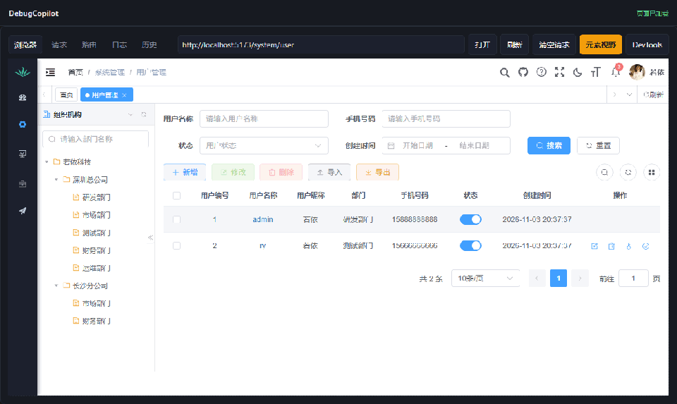

<div align="center">

# DebugCopilot

**本地联调排障工作台：抓包、日志、源码与 AI 诊断放在一个窗口里**

[](#alpha-说明)
[](https://www.electronjs.org/)
[](https://github.com/anthropics/claude-agent-sdk)
[](https://nodejs.org/)

</div>

> [!WARNING]
> **Alpha 版本，仍在积极开发中。**
>
> 当前配置格式、数据结构和交互仍可能变化，暂不建议用于生产环境，也不保证跨版本兼容。
> 欢迎试用、提 Issue 和 Star，但请先阅读下方 [Alpha 说明](#alpha-说明)。

## 为什么需要它

本地联调一个后端接口报错，通常要在这些地方来回跳：

- 浏览器 Network 面板翻请求
- 去服务器或本地文件里 `grep` 日志
- 按 traceId / 线程名把请求和日志对上
- 再从异常堆栈跳回源码
- 最后把一堆片段复制给 AI，还担心把 token、Cookie、连接串一起发出去

真正定位问题的时间，往往不到一半；其余时间都花在**找证据**和**搬运上下文**上。

DebugCopilot 想解决的就是这一段。

## 方案

**Electron + Claude Agent SDK**，把本地联调链路收进一个桌面工作台：

```text
内嵌浏览器 / WebUI
      │
      ├─ 一键抓包：请求、响应、Console、页面元素
      ├─ 请求改道：本地 / SIT，无侵入切换
      ├─ 证据聚合：日志、线程、异常堆栈、源码
      ├─ 自动脱敏：Authorization / Cookie / Token / 密钥
      ├─ 上下文裁剪：只把真正相关的证据发给模型
      │
      └─ Claude Agent SDK
             → 带证据引用的结论
             → 修复建议 / diff 预览
             → 原地会话、编译自测、保留 / 丢弃
```

核心目标不是“让 AI 猜”，而是：

> **先把证据找齐、清理干净，再让模型在有限上下文里做判断。**

## Demo

使用开源项目 [RuoYi](https://gitee.com/y_project/RuoYi-Vue) 作为本地靶场，15 秒录屏：

1. 打开 RuoYi 用户管理
2. 切到 DebugCopilot「请求」页
3. 选中 `/system/user/list`
4. 一键开始诊断
5. 观察 AI 基于请求、日志、源码逐步分析



> 演示数据来自 RuoYi 的开源示例数据；本项目与 RuoYi 官方无隶属关系。

## 核心能力

| 能力 | 说明 |
| --- | --- |
| 一键抓包 | 内嵌浏览器直接捕获请求/响应/Console，无需装插件或代理证书 |
| 请求改道 | 本地与 SIT 之间切换，支持预检/CORS 处理与原始鉴权头恢复 |
| 证据聚合 | 请求、响应、日志、线程、前端错误、源码与元素信息统一成证据包 |
| 元素视野 | 点选页面元素，提取组件、样式、附近请求，并围绕元素做诊断 |
| AI 诊断 | Claude Agent SDK 输出结论、证据引用、修复建议与风险等级 |
| 原地会话 | Git 工程真实施工，带 prewrite 快照、journal、仓库锁与崩溃恢复 |
| 每文件版本 | 同一文件多次修改保留版本链，可把单个文件回退到指定版本 |
| 显式收尾 | 修改结束必须选择「保留 / 丢弃」，不会静默留在工作区 |
| 自动脱敏 | 工具结果、证据、提示词与结果文件统一清理敏感头与密钥 |
| 多入口 | 桌面版、WebUI、CLI 共用同一套诊断与证据链路 |

## 快速开始

环境要求：

- Node.js >= 20
- 桌面版主要在 Windows 上验证；Electron 本身跨平台，但其他平台尚未完整验收

```bash
git clone https://github.com/PotterYi/OpenDebugCopilot.git
cd OpenDebugCopilot
npm install
npm run desktop
```

运行测试：

```bash
npm test
```

CLI 示例：

```bash
npm run cli -- run scenarios/<your-scenario>.json --mock
```

## Claude 认证

默认跟随 Claude Code 的用户设置：

```text
~/.claude/settings.json
  env.ANTHROPIC_AUTH_TOKEN
  env.ANTHROPIC_BASE_URL
```

也可以在「模型 → Claude 凭据…」中配置：

- 跟随 Claude Code 设置
- 自定义 Token（safeStorage 加密保存）
- 环境变量模式

Token 不会回传到渲染进程，也不会写入日志或诊断结果。

## 安全与隐私

- 默认本地运行；除发送给 LLM 的诊断上下文外，不主动上传业务数据
- 请求/响应头、工具结果、证据包、提示词和落盘结果统一脱敏
- `result.json` 不保存原始 `Authorization` / `Cookie` / `Set-Cookie`
- 完全权限模式不会逐次确认 Edit/Write，但危险 Bash 命令仍需额外确认
- 原地修改结束必须显式保留或丢弃；崩溃后通过 journal 恢复
- 非 Git 工程使用隔离副本，不直接改真实工作区

## Alpha 说明

当前是 **Alpha**：

- 配置格式、JSON 字段、CLI 参数仍可能调整
- Claude SDK 的提示词、工具编排与上下文策略仍在调优
- 部分平台/工程类型尚未完整验证
- 不建议直接用于生产环境或无人值守场景

遇到问题、想要某个能力，欢迎提 Issue。

## Roadmap / WIP

- [x] 内嵌浏览器、请求捕获、路由改道
- [x] 日志/线程/源码/元素证据聚合
- [x] 原地工作区会话：baseline、journal、锁、保留/丢弃、崩溃恢复
- [x] 每文件版本历史与单文件回退
- [x] 工具结果与证据统一脱敏
- [ ] **基于 AST 的代码图谱（星空图）**
- [ ] Claude SDK 提示词与工具调用策略持续调优
- [ ] 更多工程类型、场景模板与 CI 集成
- [ ] 稳定版配置与数据格式

> **WIP：目前正在开发基于 AST 的代码图谱（星空图），以提升复杂链路的诊断能力，欢迎 Star 追踪进度。**

## 项目结构

```text
src/
  agent/        Claude Agent SDK 适配层
  app/          Electron / WebUI / CLI 入口
  core/         配置、会话、沙箱、锁、脱敏、版本快照
  diagnose/     诊断编排
  driver/       浏览器 / HTTP / 元素驱动
  evidence/     日志、源码、数据库、前端证据
  report/       白名单报告
  tools/        进程内 MCP 工具
  ui/           零框架前端
verify/         单元测试与 Electron 冒烟
docs/           设计、部署与验收文档
```

## 文档

- [文档索引](docs/README.md)
- [总体架构](docs/03-总体架构.md)
- [数据模型与接口](docs/04-数据模型与接口.md)
- [技术选型与安全](docs/05-技术选型与安全.md)
- [RuoYi 靶场部署](docs/14-RuoYi靶场部署.md)

## 参与贡献

项目还在早期，欢迎：

- 试用并反馈真实工程中的问题
- 提 Issue 描述复现步骤、日志与工程类型
- 提 PR 补充场景模板、测试或文档
- Star 支持项目继续迭代

## 致谢

- [RuoYi](https://gitee.com/y_project/RuoYi-Vue)：用于本地联调与演示的开源后台系统
- [Claude Agent SDK](https://github.com/anthropics/claude-agent-sdk)：AI 诊断执行层

本项目与 RuoYi、Anthropic 均无隶属关系。

## License

当前仓库尚未添加 LICENSE 文件；正式稳定发布前会补充开源协议。

---

如果 DebugCopilot 对你的本地联调有一点帮助，欢迎点一个 **Star**。
